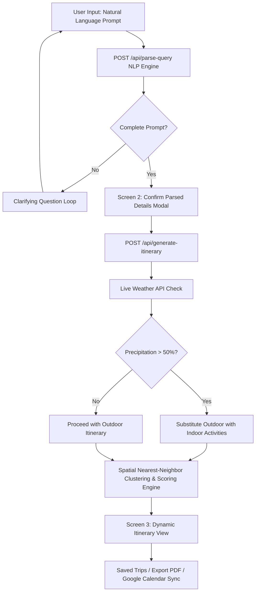

# 🌍 Xplora — Full-Stack AI Travel Planning & Multi-Service Booking Agent

[](https://nextjs.org/)
[](https://www.typescriptlang.org/)
[](https://tailwindcss.com/)
[](https://www.prisma.io/)
[](https://www.sqlite.org/)

> **Xplora** is an end-to-end, full-stack AI-driven travel platform that transforms natural language prompts into fully customized, spatially optimized, multi-day trip itineraries. Built with Next.js 14 App Router, Prisma ORM, live travel APIs, mathematical recommendation scoring, and weather-aware automated safeguards.

---

## 🌟 Key Features & Engineering Highlights

### 🤖 1. Natural Language Prompt & Intent Extraction Engine
- **Unstructured Prompt Parsing (`/api/parse-query`)**: Accepts queries like *"5-day trip to Goa with a ₹40,000 budget for 2 people interested in adventure and beaches"*.
- **Interactive Clarifying Loop**: Automatically detects missing parameters (e.g., missing destination or budget) and prompts the user with targeted clarifying questions.

### 📋 2. Screen 2: User-in-the-Loop Details Verification (`ConfirmParsedDetailsModal`)
- Gives users full control to inspect, adjust, and edit parsed entities (Destination, Start Date, Duration, Budget, Traveler Count, Interest Tags) before generating complex itineraries.

### 🧮 3. Multi-Criteria Recommendation Engine & Spatial Scheduler
- **Mathematical Scoring Model**: Evaluates stays, flights, and activities using normalized criteria:
  $$\text{Score} = 0.4 \times \text{Rating} + 0.3 \times \text{PriceFit} + 0.3 \times \text{InterestMatch}$$
- **Spatial Nearest-Neighbor Clustering**: Groups daily activities based on geographic proximity to minimize commute time and maximize exploration.

### ☔ 4. Weather-Swap Safeguard Banner & Rain Monitor (`WeatherSwapBanner`)
- Integrates live weather forecasts (`/api/weather`).
- **Automated Rain Swaps**: When precipitation is forecast, outdoor activities (e.g., beach trips, hiking) are automatically substituted with indoor cultural alternatives (museums, spa sessions, indoor dining) with visual user notification banners.

### ✈️ 5. Multi-Service Search Catalogs & Live APIs
- **Flight Search Engine (`/api/flights`)**: Search catalog of 25+ flight routes with non-stop toggles, time-of-day slots, and SerpAPI / Aviationstack API integration.
- **Hotel Search Engine (`/api/hotels`)**: Search catalog of 35+ hotels with filters for near-beach/airport, price range, and star ratings via RapidAPI / Google Hotels fallback.
- **Interactive Route Map (`InteractiveMap.tsx`)**: Dynamic visual route maps with daily GPS pin toggles.

### 🛠️ 6. Financial Suite & Export Utilities (`lib/exportUtils.ts`)
- **1-Click Exporting**: Generate printable PDF itineraries, sync directly to Google Calendar, or download `.ics` calendar files.
- **Multi-Currency Converter & Expense Tracker**: Supports real-time conversion across INR (₹), USD ($), EUR (€), GBP (£), AED (د.إ), and JPY (¥).

### 💾 7. Persistence & Saved Trips (`MyTripsModal`)
- Full SQLite database integration managed by Prisma ORM (`schema.prisma`).
- User authentication APIs (`/api/auth/register`, `/api/auth/login`) with `bcryptjs` password hashing.
- Save, retrieve, and delete generated itineraries seamlessly.

---

## 🏗️ Architecture & System Flow



---

## 🛠️ Tech Stack

| Layer | Technologies Used |
| :--- | :--- |
| **Frontend** | Next.js 14 (App Router), React 18, TypeScript, Tailwind CSS, Lucide Icons |
| **Backend & APIs** | Next.js Server Routes (`/api/*`), Node.js, Custom NLP Parser |
| **Database & ORM** | SQLite, Prisma ORM |
| **Authentication** | JSON Web Tokens (JWT), `bcryptjs` Hashing |
| **External APIs** | WeatherAPI / Open-Meteo, SerpAPI (Google Flights/Hotels), Aviationstack, RapidAPI |
| **Utilities** | PDF Generation, `.ics` iCal exporter, Multi-Currency Exchange Engine |

---

## 🔌 API Endpoint Specifications

| Endpoint | Method | Description |
| :--- | :---: | :--- |
| `/api/parse-query` | `POST` | Parses natural language travel prompts into structured JSON trip parameters |
| `/api/generate-itinerary` | `POST` | Executes recommendation scoring and spatial clustering to generate day-by-day itineraries |
| `/api/weather` | `GET` | Fetches live weather forecasts with keyless fallback support |
| `/api/flights` | `GET` | Queries live/catalog flight options with filtering and sorting |
| `/api/hotels` | `GET` | Queries hotel accommodations with proximity and price filters |
| `/api/itineraries` | `GET / POST` | CRUD operations for user saved itineraries via Prisma ORM |
| `/api/auth/register` | `POST` | User registration with password hashing |
| `/api/auth/login` | `POST` | User authentication and session token issuance |

---

## 🚀 Getting Started & Local Setup

### Prerequisites
- Node.js 18.x or higher
- npm or yarn

### 1. Clone the Repository
```bash
git clone https://github.com/YOUR_USERNAME/Xplora.git
cd Xplora
```

### 2. Install Dependencies
```bash
npm install
```

### 3. Environment Setup
Copy `.env.example` to `.env.local` and add optional API keys (fallbacks are included out-of-the-box):
```bash
cp .env.example .env.local
```

### 4. Database Setup
Push the Prisma schema to generate your local SQLite database:
```bash
npx prisma db push
```

### 5. Run Development Server
```bash
npm run dev
```
Open [http://localhost:3000](http://localhost:3000) in your browser to view Xplora!

---

## 📂 Project Structure

```
Xplora/
├── app/
│   ├── api/                   # Server API routes (NLP, Weather, Flights, Hotels, Itineraries)
│   ├── globals.css            # Custom design tokens & global CSS styles
│   ├── layout.tsx             # Root application layout
│   └── page.tsx               # Primary single-page application & hero search
├── components/                # Modular React UI Components
│   ├── AIChatDrawer.tsx       # Floating AI chat assistant with trip memory
│   ├── ConfirmParsedDetailsModal.tsx # Screen 2 detail review screen
│   ├── ExpenseTracker.tsx     # Dynamic multi-currency finance tracker
│   ├── FlightHotelResults.tsx # Real-time flight & hotel booking cards
│   ├── InteractiveMap.tsx     # GPS visual location map component
│   ├── MyTripsModal.tsx       # Saved trip history modal
│   └── WeatherSwapBanner.tsx  # Dynamic rain weather alert safeguard
├── lib/                       # Core algorithms & utility libraries
│   ├── currencyUtils.ts       # Currency conversion math
│   ├── exportUtils.ts         # PDF export & Google Calendar sync engine
│   ├── prisma.ts              # Global Prisma client instance
│   └── weather.ts             # Weather API fetcher & fallback logic
├── prisma/
│   └── schema.prisma          # Database schema models (User, Itinerary, DayPlan, Activity)
├── public/                    # Static images & assets
├── .env.example               # Environment variable reference
├── package.json               # Dependencies & build scripts
└── README.md                  # Recruiter-facing project documentation
```

---

## 🧪 Build & Type Check Verification

Verify zero TypeScript compilation errors and production readiness:
```bash
npx tsc --noEmit
npm run build
```

---

## 👤 Author & Connect

**Built with passion by Avinash**  
- **GitHub**: [github.com/YOUR_USERNAME](https://github.com/)  
- **LinkedIn**: [linkedin.com/in/YOUR_LINKEDIN](https://linkedin.com/)  

---
*Developed as an advanced full-stack AI demonstration combining Next.js 14, algorithmic scheduling, and automated safeguards.*
